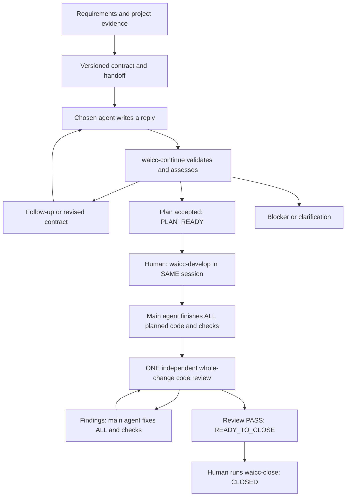

# WAICC — Whatley AI Communication Contract

_Clear contracts. Connected agents._

`pi-waicc` is a Pi extension that turns a development request into versioned
contracts, agent handoff prompts, and a durable conversation inside your project.
It is designed for complicated work that needs explicit requirements, task
dependencies, focused design advice, independent planning or review, and continuity across agents.

The contract defines the job. The handoff prompt tells an agent how to perform it
and where to reply. Pi validates that reply, assesses the evidence, and prepares
the next decision or handoff. A fresh agent can pick up the assignment without
needing the original chat history.

## Install

Requires **Node.js 22.19+** and the **`@earendil-works` Pi coding-agent host**.
Developed and tested on native Windows with Pi 1.2.0; other platforms have not yet
been verified.

```sh
pi install git:github.com/whatley95/pi-waicc
```

Restart Pi or use `/reload`, then open your target project and resolve Pi's project
trust prompt before using WAICC. The package exposes the extension and all 15
skills: the 14 WAI skills plus the WAICC workflow skill.

To install for one project, run this from that project:

```sh
pi install --local git:github.com/whatley95/pi-waicc
```

For local development, use an absolute path to your clone:

```sh
pi install /absolute/path/to/pi-waicc
```

To update an existing Git install to the latest version, then `/reload` (or restart) Pi:

```sh
pi update git:github.com/whatley95/pi-waicc
```

Pi keeps its own copy of the package (see `pi list`); new commands such as
`/waicc-dispatch` appear only after that copy is updated.

WAICC is independent of pi-yoowai. If both packages are enabled, select one copy
of each shared WAI skill in Pi's resource configuration to avoid duplicate names.

## Start a conversation

In Pi, describe the actual outcome and constraints:

```text
/waicc-planning Add customer search with pagination and account isolation. Preserve the existing response format and support the current frontend.
```

Pi saves your exact request and relevant context as a requirements/constraints brief.
The recipient investigates actual source, tests/docs/history and available reference
projects, resolves technical facts and returns the detailed proposed contract/plan.
The owner verifies material claims and consolidates genuine human/external choices
instead of relaying a questionnaire.

1. **Send the planning handoff.** Give the generated `STARTER.txt` prompt to your
   chosen agent with access to the project. It reads `HANDOFF.md`, the contract,
   relevant skills and prior conversation, then writes the designated `reply.json`.
   Or let Pi run it headless: `/waicc-dispatch --via claude --model opus` (see
   [Dispatch to a headless agent](#dispatch-to-a-headless-agent)).
2. **Continue in Pi.** Run `/waicc-continue`. WAICC validates the request identity,
   contract version, requirements digest and source state. Pi then assesses the
   reply against the original requirements and actual evidence.
3. **Accept the plan.** The owner intentionally adopts supported
   corrections with `waicc_assess.contract` and uses decision `planned` for a complete
   plan. This records `PLAN_READY` without an external implementation handoff. Proposals
   are never adopted automatically.
4. **Keep genuine decisions visible.** Future human/external choices carry evidence,
   a recommendation and affected tasks in `contract.decisions`. Only those tasks
   and their dependents are gated. Questions that actually prevent a coherent
   specification still block acceptance; do not invent answers or erase blockers.
5. **Authorize development in this same session.** Run `/waicc-develop` after plan
   acceptance or a fresh specification PASS. No close/reopen/new contract is needed.
   Main codes by default; `--delegate` selects optional coordinated coding. The
   coordinator implements the entire authorized plan in dependency order,
   runs relevant checks and inspects the whole diff. No per-task or batch handoffs.
   Genuine remaining blockers must be resolved before claiming all work is done.
   A planning-only request still stops at `PLAN_READY`; accepting a plan grants no new authority.
6. **Review the whole implementation once.** `/waicc-review Review authorization, regressions and test evidence`
   asks the main agent to check completion, then produce ONE code-review handoff.
   Its completion report must cover every task, actual checks/limits and all earlier
   actionable findings. Send the copied prompt to a reviewer, then `/waicc-continue`.
   The reviewer inspects actual code changes, not merely the plan or contract.
7. **Fix everything before re-review.** If review fails, the coordinator assesses
   `needs_changes` before editing, fixes ALL findings, completes checks and requests
   ONE fresh whole-change review. Repeat until no actionable findings remain—not
   one handoff per fix. Real blockers and the explicit round limit still stop the loop.
8. **Close explicitly.** A passing whole-change assessment shows `READY_TO_CLOSE`
   and `contractReview: PASS`. Run `/waicc-close <reason>` only when you decide the
   contract discussion is finished. This does not certify code delivery.



Use one session for one development objective, with multiple request/reply rounds.
`/waicc-status` shows the current state, pending reply, last assessment and next
action. After an interruption, use `/waicc-use <session-id>` to resume.

Planning `coverage: addressed` means the source-backed plan covers the requirement,
not that code is implemented or tests pass. No builds/tests does not automatically
make all planning unverified. Actual checks retain passed/failed/not_run and their
limits; deliveryVerified stays false. A grep hit is not proof of behavior.

Owner/planner/reviewer/advisor all receive source-first instructions. The owner must
save adopted revisions, carry decisions forward and avoid unchanged follow-up loops.
Schema validity cannot independently prove investigation quality or human approval.
Code-review completion reports are evidence-backed coordinator claims, not proof;
the reviewer independently verifies them. Unavailable checks stay `not_run` with
limits; missing required evidence is a blocker, not a fabricated pass.

For specification-only work, explicitly use `/waicc-review --contract <focus>`.
That review may retain future execution gates and its PASS is not code approval.
`reviewApproval.kind` distinguishes `code` from `contract`; legacy unmarked reviews
remain specification-only and are never silently upgraded.

### Automatic planning — on by default

Describe work normally—no setup command is required. For example: “Rename this
setting, update its documentation, then check both agree.” The main model plans
whenever tracked steps would help it keep the work on track, **not only for complex
tasks**. Multiple meaningful steps, dependencies, separate completion checks or
changes that must stay coordinated are enough. Keep the plan proportional to the job.

WAICC captures your input using `waicc_start_planning`, saves important prior
context and prepares one planning brief/handoff. The planner investigates the code
and returns the detailed plan. This uses the current model's normal turn, not an
extra classifier or worker process.

To show the current setting, turn it off, or re-enable it:

```text
/waicc-auto-planning
/waicc-auto-planning off
/waicc-auto-planning on
```

Trivial one-step edits, explanations, status questions and exploratory discussion
should not start new contracts. Whether tracked planning would help is model judgment,
not a guaranteed classifier.
Put `[no-plan]` at the beginning of a message to mechanically skip automatic startup
for that input. It does **not** bypass an existing contract's scope or coding guards.
Manual `/waicc-planning` is always available.

Related follow-ups use the selected contract unchanged. Pending packets are not
rewritten or duplicated; unrelated/new scope needs an explicit human choice. If
no contract is selected but open sessions exist, WAICC asks for `/waicc-use <id>`
or an explicit new `/waicc-planning` rather than choosing for you. Closed, deleted
or missing selections are never silently replaced.

The setting defaults **on**, including new chats and existing branches without a
saved preference. Explicit `off` preferences remain off across reload/resume;
use `on` to re-enable. Overrides apply only to this Pi chat/project branch. Old
`complex` commands/settings remain compatible as an alias for `on`, using the new
step-tracking policy. Startup requires a fresh idle human prompt
(interactive or RPC). Slash commands, extension-generated/custom messages,
transformed inputs and queued/steered messages do not trigger startup; send a fresh
ordinary prompt when needed. Handoff recipients cannot enable or use it.

The handoff still uses the existing clipboard/manual-copy flow. Send it to your
chosen planner, then `/waicc-continue` in the coordinator. Auto-planning never
launches another agent, adopts a reply, amends scope, confirms memory, closes a
contract or authorizes implementation. After plan acceptance, you still explicitly
run `/waicc-develop`.

### Specification approved, now develop

`SPEC_APPROVED` means specification review PASS, not code completion or permission.
`/waicc-develop [--main|--delegate]` explicitly accepts/authorizes the current ready
plan and changes objective to development. It records version, requirements, paths,
source baseline and provenance without changing the contract or consuming a round.
`READY_TO_IMPLEMENT` has no unresolved decision gates; `IMPLEMENTATION_GATED` has a
valid grant but still-blocked tasks. Main may do genuinely unblocked authorized work;
whole-plan delegation and full code review wait until gates are resolved.

`/waicc-decisions` shows the consolidated owners, evidence, recommendations and
affected tasks. `/waicc-decide D1 <answer>` records an existing gate's answer as a
versioned human decision with an audit, not an automatic scope amendment. Pending
handoffs must be finished/cancelled first. The command cannot change task/path/scope
fields or replace an already established answer. It may explicitly repin a current
grant for that narrow answer-only revision, but never carries review PASS. Ordinary
revisions/amendments invalidate authority and require renewed `/waicc-develop`.

Status exposes objective/phase, plan acceptance, separate spec/code reviews, recorded
implementation authorization and its reason, open gates, reported task counts and
phase/overall round budgets. Unknown progress is `null`, not zero; reported completion
is not verification. Legacy specification records keep their history and can use the
same development command; omitted old review kinds display `legacy_contract`.

New Pi/CLI sessions start planning-only with an overall 20-round cap and phase caps
(specification 8, implementation 6, testing 4, code_review 8, advisor 4). Both limits
apply. `/waicc-limit code_review 10` changes that phase explicitly; `/waicc-limit 20`
changes only the overall limit. Existing caps are retained; transitions/answers
never reset usage or silently raise limits. The low-level API retains legacy behavior
when objective is omitted for backward compatibility; new integrations should pass it.

The grant does not create OS isolation, production authority or shell permissions.
Coordinator edit/write guards honor it; agents must not bypass it using other tools.

## Optional coding and testing handoffs

The main agent codes by default. To keep it as coordinator from the start:

```text
/waicc-planning --delegate Add customer search with account isolation. Preserve the existing API.
```

After plan adoption, `/waicc-develop` authorizes work in the same session, then the
coordinator prepares ONE whole-plan handoff when execution gates are resolved. You can also
select delegation later with `/waicc-help-develop [focus]`. This means implement the
entire accepted plan—or ALL outstanding fixes—not one task at a time. The coding
agent should run relevant permitted checks and return a whole-work completion report.
`/waicc-implement` remains a compatibility alias with the same options and safeguards.
`/waicc-continue` makes the coordinator inspect the actual diff, coverage, fixes and
check evidence before deciding what is next. It does not blindly turn a ready reply
into review PASS or immediately send completed code back for implementation.
Delegation is optional: the contract owner can always do the authorized work.
To return a delegated role to the main agent, use `/waicc-help-develop --main [focus]`
or `/waicc-test --main [focus]`. Finish/cancel a pending assignment first; changing
ownership does not stop an external worker. These switches create no new handoff.

If checks are missing, the main agent can run them itself. Optionally use
`/waicc-test [focus]` to delegate ONE consolidated testing assignment. A tester runs
permitted checks and reports results; it does not edit code/tests or implement fixes.
Unavailable checks remain not_run. Implementation with unrun checks can reach
NEEDS_TESTING; supported implementation/testing reaches NEEDS_REVIEW, never PASS.
Finish ALL fixes/checks before ONE independent full code review. A separate tester
is optional, not a mandatory handoff on every cycle. Neither command launches agents.

Every new handoff includes CONTEXT.md/context.json, original requirements and all
amendments, complete saved round conversation, prior findings/checks, relevant skills
and a confirmed-memory snapshot. Recorded local check logs travel under evidence/.
The owner saves important chat-only domain facts, constraints, references and decision
rationale with waicc_context before dispatch; uncaptured chat cannot be recovered.
The context packet supplements—not overrides—the contract or permissions. Large Pi
assignments point to the full saved files instead of injecting an oversized history.

### Automatic checkpoints and compact context

WAICC automatically saves `CHECKPOINT.md` (small recovery brief) and `checkpoint.json`
(complete ID/evidence index) with workflow transitions, including plan adoption,
implementation/testing/review assessment and each new handoff. Records are derived
from canonical state, not repeatedly summarized from an older summary. Requirement,
task/acceptance, decision and finding IDs, source/version labels and original evidence
references remain recoverable. Full history and test logs stay on disk, not in every prompt.

Pi still owns chat compaction and its normal automatic threshold. WAICC validates
recovery evidence before Pi compacts and supplies a compact checkpoint on the next
model request (including mid-run overflow retries), or after session reload. It does not install a second threshold,
delete history, create another handoff, change ownership or automatically approve work.
Corrupt recovery evidence cancels compaction with an error instead of hiding it.

For an immediate manual compaction in the selected chat:

```text
/waicc-compact
```

Optionally append important chat-only context first:

```text
/waicc-compact Keep the old API shape because older mobile clients are still supported.
```

Notes append to saved coordinator context and remain supplementary claims, not new
requirements. Notes cannot be saved while a handoff is pending or from recipient mode;
plain `/waicc-compact` still works without altering that frozen packet. Closed sessions
remain read-only. Recipients recover only their exact issued checkpoint, not a newer
owner assignment, and compaction never widens editing/check permissions.

Agents can call `waicc_checkpoint` for read-only compact recovery and expand exact
contracts/original evidence when needed. Full code review must still cover every
requirement/task/acceptance criterion and every prior actionable finding. Old checks
are not proof for changed code; failed/not-run limits and source mismatches stay visible.
Automatic indexing cannot capture unsaved chat-only decisions: save them with
`waicc_context` when allowed; Pi retains/summarizes its own chat. No short summary is
a guarantee of lossless chat recall.

CLI `waicc checkpoint <session-id>` reads recovery state. `waicc compact <session-id>`
validates/creates the checkpoint only; it does not compact a Pi chat. Portable exports
include the frozen checkpoint and exact indexed originals under `archive/`; checkpoint
artifact paths resolve relative to that folder. Source access is still needed separately.

### Review findings must be useful to fix

Reviewers are instructed to provide `{id,severity,description,evidence,suggestedFix}`:
explain the defect/impact, cite source path and line/symbol or actual failing check,
identify the triggering case and expected versus observed behavior, then recommend
a minimal in-scope fix and regression verification. Static source proof is valid;
an unrun reproduction must never be described as executed. Unconfirmed suspicions
stay labelled as such. Evidence is mandatory, and the owner independently verifies it.

`suggestion`, `recommendation`, `fix` and `suggested_fix` can be normalized into
suggestedFix, with original annotations/raw replies preserved. Suggested fixes are
advice—not executable commands, permission or automatic scope changes. Older replies
without suggestions remain readable; the owner investigates and derives a supported
remedy instead of requiring another handoff solely to rewrite the reply.

## Manual handoff: exactly what to give

Run this in the coordinating Pi chat whenever you need clear copy/paste instructions:

```text
/waicc-handoff
```

Or specify `/waicc-handoff <session-id>`. It displays a **copy-only prompt block**
and keeps the human's return steps outside it. This does not start inference,
issue another request or change the contract. It also works for existing pending
handoffs without rewriting their committed files.

Interactive Pi automatically copies **only the recipient prompt** for a new handoff.
Paste with Ctrl+V (Cmd+V on macOS). `/waicc-handoff` copies again on demand; ordinary
status/use reads do not repeatedly overwrite the clipboard. Export copies the portable
prompt; it still needs the entire export folder and matching source. Replies do not copy.

This reuses Pi's Windows/macOS/Linux clipboard support (native helpers, Wayland/X11,
WSL and supported terminal forwarding). Linux may need wl-clipboard or xclip/xsel
and display access. Remote OSC 52 depends on terminal permissions and cannot be
independently confirmed. Missing clipboard access is reported with a manual fallback;
it never invalidates the handoff. RPC/JSON/print modes do not write the host clipboard
or emit clipboard control sequences. Tests mock the writer rather than live macOS/
Linux desktops; no OS packages are installed automatically. Copying replaces the
clipboard's existing text.

- **Same computer/project access:** open the other agent in the project, then paste
  the complete prompt block (or the **contents** of `STARTER.txt`). Do not give it
  just the file path or the coordinator's entire status/assessment message.
- **Files to read, not separately paste:** the prompt points to `HANDOFF.md`, which
  links requirements, contract, conversation, skills and reply template. The agent
  needs permission to read these hidden/ignored `.pi/pi-waicc` files.
- **Different computer/no local-path access:** `/waicc-export`, provide the **entire
  export folder**, and paste its `STARTER.txt` contents. Provide access to matching
  source separately; the export contains no code. A `HANDOFF.md` attachment alone
  does not include the other inputs. Review content before sharing.
- **After the reply:** return to the coordinator for this session and run
  `/waicc-continue`. If its selection is different, first `/waicc-use <session-id>`.
  These are your return steps, not commands to send to the recipient.

Only use one recipient per request. When `reply.json` already exists, the copy view
is withheld and status directs you to intake/validation, not another handoff. A
failed validation may require an explicitly requested reply repair, not a new worker.
`waicc_status` exposes the same instructions as `manualHandoff` before the large
contract body, so the coordinator can present them even with a bounded tool preview.

## Receive in another Pi chat

You can use different models for the two roles without launching another process
from WAICC. For example, prepare the contract with DeepSeek in Pi chat A, then
manually open Pi chat B in the **same project checkout**, select Claude using Pi's
normal model controls, and run:

```text
/waicc-receive <session-id>
```

Use the WAICC session ID from `/waicc-status`, not a Pi chat ID. The receiver finds
that session's single waiting request and pins its request ID, contract version,
requirements digest, source fingerprint and mode. It loads the original scope,
handoff, exact contract, saved context, complete conversation, selected skill paths
and the confirmed-memory snapshot frozen at issue. The current Pi model performs the recipient role.

The recipient submits through `waicc_reply` and stops. Back in coordinating chat A:

```text
/waicc-continue
```

Submission only writes the designated `reply.json`; it does not import, assess,
revise or close the contract. The coordinator validates and assesses the reply as
usual. External CLI/agent handoffs remain available using `STARTER.txt` and the
same reply format. Choose one recipient per request: receiving is not a worker
reservation, and multiple workers could duplicate investigation. The first reply
file wins; the receiver never overwrites an existing reply.

Recipient mode exposes read/search tools, confirmed-memory recall and reply
submission. It blocks coordinator mutations and shell/MCP/custom execution tools.
Planning, review and advisor recipients cannot edit source. For an implementation
request, **only if you want this Pi chat to edit the assigned code**, opt in with:

```text
/waicc-receive <session-id> --implement
```

This also enables direct `edit`/`write`, restricted to the request's task paths.
General shell/MCP/custom execution remains blocked. To optionally run local checks:

```text
/waicc-receive <session-id> --implement --run-checks
```

For a testing-only assignment use `/waicc-receive <session-id> --run-checks` instead.
`waicc_check` requires interactive confirmation of EACH exact program/argument list,
runs at project root and logs actual exit/output plus source fingerprints. No UI or
approval means not_run. This opt-in is not restored on reload; explicitly receive
the same request with --run-checks again. Other execution tools remain blocked.
Commands/scripts can write files, contact services and spawn processes with your
account permissions: this is not an OS sandbox. No production, installs, credentials,
resets or deployment. A tester changing source gets a failed check and must stop
for a fresh handoff; WAICC never automatically reverts files. External coding/test
agents keep their own permission model, never extra authority from the prompt.

The recipient binding survives Pi chat resume. It never automatically receives a
newer request: cancelled, replaced, closed or answered assignments stop. Source
freshness is checked at receive and submission; implementation may change source
within its assigned scope, checked again at coordinator intake/assessment.
`waicc_status` in recipient mode recovers the pinned assignment. To deliberately
leave that role, the human runs `/waicc-use <session-id>`; this restores the chat's
previous active tool selection. Switching provider/model remains a normal Pi action.
WAICC launches no agent on its own and runs no background scheduler; only your explicit
`/waicc-dispatch` starts a recipient process, and only an explicitly opted-in,
individually confirmed local check launches a check program.

## Dispatch to a headless agent

Instead of copying the handoff into another agent, you can have the coordinator run
it headless with the agent and model you choose. Pi still does every assessment and
you still make every decision. A typical mixed-model session:

```text
/waicc-planning Add customer search with account isolation.
/waicc-dispatch --via claude --model opus            # Claude plans
/waicc-continue                                      # Pi assesses; you accept → PLAN_READY
/waicc-develop                                       # main agent codes
/waicc-review Check authorization and regressions
/waicc-dispatch --via codex -m gpt-5.5               # Codex reviews (a different model family)
/waicc-continue
```

`/waicc-dispatch --via claude|codex|pi|agy [--model <model>] [--timeout <minutes>] [--implement] [--check "<command>"]... [--check-timeout <minutes>]`
runs the selected session's single waiting handoff in the background. This chat stays
usable; you are notified when the agent finishes, then run `/waicc-continue`.
`/waicc-dispatch --stop` ends a running agent. The CLI equivalent runs in the
foreground: `waicc dispatch <session-id> --via codex`.

| `--via`  | Runs                                 | Read-only enforcement                                   | Model flag              |
| -------- | ------------------------------------ | ------------------------------------------------------- | ----------------------- |
| `claude` | `claude -p` (Claude Code)            | Edit/Write/NotebookEdit/Bash disallowed; only WAICC MCP. Coding: edits in an isolated worktree, no shell | `--model opus` |
| `codex`  | `codex exec`                         | `--sandbox read-only` (OS sandbox); only WAICC tools approved. Coding: `workspace-write` in an isolated worktree | `-m <model>` |
| `pi`     | `pi -p` with this extension          | WAICC's own recipient mode: read/search tools; with `--implement`, edit/write only inside task paths | `--model provider/id` |
| `agy`    | `agy -p` (Antigravity CLI)           | Its headless mode soft-denies unapproved tools          | `--model <slug>`        |

What it does and does not do:

- **One recipient per request.** Dispatch refuses while a reply exists or another
  dispatched agent is still working on the same request.
- **Coding needs `--implement`.** Planning, review and advisor handoffs go to any agent
  read-only. A delegated implementation handoff is dispatched only with `--implement`:

  - **Pi codes in place.** WAICC's recipient mode allows edit/write inside the task's
    allowed paths and blocks every other path and all shell commands as they happen.
  - **Claude and Codex code in an isolated Git worktree.** Dispatch snapshots exactly the
    files the handoff fingerprinted (uncommitted and untracked work included) through a
    temporary index, so your checkout and staging area are untouched, and the agent
    edits only that copy. When it finishes, WAICC applies its changes **all or nothing**:
    only if a reply was submitted, every changed file is inside the task's allowed paths
    and your checkout has not changed meanwhile. Otherwise nothing is applied and the
    copy is kept for you to inspect. Codex runs in `--sandbox workspace-write` and can run
    commands without network. Claude has no shell. Isolation needs a Git checkout;
    Antigravity is refused.
  - **Dependencies are linked, not copied.** Top-level `node_modules`, `.venv` and `venv`
    folders that Git ignores are linked from your project into the copy, so tests can
    run there. They are never part of the agent's changes, and removing the copy removes
    only the link. Writes through the link (such as a test cache) land in your folder.

  ```text
  /waicc-develop --delegate
  /waicc-dispatch --via codex --implement --check "npm test"   # isolated worktree
  /waicc-dispatch --via pi --implement --model deepseek/deepseek-flash   # or in place
  /waicc-continue
  ```
- **Pre-approved checks: you choose the exact commands.** Each `--check "<command>"`
  approves one exact command (program and arguments; use single quotes inside it for an
  argument with spaces, for example `--check "node --test 'tests/a b.ts'"`). The agent
  can run only those, by number, through WAICC's `waicc_run_check` tool (Pi: `waicc_check`
  with the exact command), never through its own shell. WAICC runs each at the project
  root (in the isolated copy for Claude/Codex coding), logs its exact output, exit code
  and source state in the round, and the agent cites that result. `--check-timeout`
  allows 1–30 minutes per check (default 10); at most 10 checks.
  - **Testing handoffs can now be dispatched,** with at least one `--check`; the tester
    stays read-only. A test run that changes source fails, as with interactive checks.
  - **Coding agents can run them too,** to verify their own work before submitting.
  - Checks run with your account's permissions and are not an OS sandbox: approve only
    local, reviewed commands, never deployments, installs or anything using secrets.
    Antigravity cannot receive pre-approved checks.

  ```text
  /waicc-test
  /waicc-dispatch --via claude --check "npm test" --check "npm run lint"
  /waicc-continue
  ```
- **The agent is pinned.** Claude and Codex get a per-run WAICC MCP server that refuses
  every request except the dispatched one; Pi pins it at startup.
- **Replies are validated before they are written.** Agents check drafts with
  `waicc_validate_reply` (Pi: `waicc_reply` with `validateOnly`) and fix every reported
  problem before the single submission, so `/waicc-continue` receives a valid reply.
  Planning and review assignments include a valid `proposedContractExample`, and an
  invalid proposal's error names the failing part and shows that example.
- **Audit log.** Each run records the agent, model, exact arguments, exit code and
  output tail under the round's `dispatch/<id>/` folder.
- **Never assesses, accepts, closes or retries.** A failed run leaves the handoff
  waiting: read the log, dispatch again, try another agent, or hand it off manually.
- **Sign in first.** Each CLI must already be installed and signed in; headless runs
  cannot log in. On Windows, npm/Volta `.cmd` shims are supported.
- **Source must match the handoff.** If source changed since the handoff was issued,
  dispatch refuses and asks for a fresh handoff. A reviewer that edits code anyway
  cannot submit: its reply fails the source-fingerprint check.

Context travels through the saved session files, not chat: every dispatched agent
reads the same requirements, contract, saved context, complete round history, prior
findings, skills and confirmed memory as a manual recipient. Save important chat-only
facts with `waicc_context` (or `/waicc-compact <note>`) before dispatching.

Verified live on Windows 11 with Claude Code 2.1 (Sonnet), Codex CLI 0.163 and Pi 1.2.0
(DeepSeek V4 Pro): each pinned the request, corrected rejected drafts through dry-run
validation, submitted once and left source untouched. Slower models can take well over
ten minutes; the default timeout is 30 minutes. `/waicc-dispatch --via pi --implement`
was also verified from a real Pi coordinator: DeepSeek Flash implemented the accepted
task inside its allowed path in under a minute, and the coordinator accepted the reply.
Isolated coding was verified live too: Codex and Claude (Sonnet) each implemented an
accepted task in their worktree, WAICC applied the single in-scope file and removed the
copy, and the coordinator accepted both replies, including in a Git repo with no commits.
Pre-approved checks were verified live: a Claude tester ran `--check "node --test
index.test.js"` through `waicc_run_check` (logged as passed), and Codex implemented a
function plus its test in a worktree, ran the same approved check inside the copy, and
WAICC applied both in-scope files.
**Antigravity (`agy`) support is experimental and untested:** it reads MCP
servers from its own configuration, so add WAICC once in `~/.gemini/config/mcp_config.json`:

```json
{ "mcpServers": { "waicc": { "command": "waicc", "args": ["mcp"] } } }
```

and allow its `waicc_*` tools in `~/.gemini/antigravity-cli/settings.json`, otherwise
headless runs soft-deny them. Check `agy models` for exact model slugs.

### Agent profiles: choose an agent per role once

Instead of typing `--via` and `--model` on every dispatch, name your agents once and give
each role a default. A plain `/waicc-dispatch` then picks the agent from the waiting
handoff's role:

```text
/waicc-dispatch                    # planning handoff → your planning profile
/waicc-dispatch                    # review handoff   → your review profile
/waicc-dispatch --implement        # coding still needs --implement every time
/waicc-dispatch deepseek           # use another profile once
/waicc-dispatch --effort high      # or override one setting once (also --model)
/waicc-dispatch --profiles         # show what each role resolves to
```

#### Which agent for which role

These are suggestions from WAICC's own live runs on a small project; your results will
vary with project size, models and pricing.

| Role             | Suggested agent | Why |
| ---------------- | --------------- | --- |
| `planning`       | Claude (Opus for large work, Sonnet otherwise) | Fast and produced a valid plan after one correction (Sonnet: 82 s, about $0.27); a strong model pays off where the plan is decided |
| `review`         | A **different model family** from whoever coded: Codex if Claude or Pi coded, Claude if Codex coded | An independent reviewer catches different mistakes than the author |
| `implementation` | Codex | Codes in an isolated worktree with an OS sandbox, can run its own commands and pre-approved checks (about 2 minutes per small task) |
|                  | Pi with a fast model (for example DeepSeek Flash) | Cheap and quick for small in-place changes (53 s), edits confined to task paths, no shell |
|                  | Claude | Good for small changes in a worktree; it has no shell, so give it `--check` commands |
| `testing`        | Claude (Sonnet or Haiku) with `checks` | The tester mainly runs approved checks and reads their output (Sonnet: 52 s, about $0.19) |
| `advisor`        | A cheaper model through Pi (for example DeepSeek) | Focused questions rarely need the strongest model |

Model names change. Claude accepts aliases (`opus`, `sonnet`, `haiku`, always the latest)
or exact IDs such as `claude-opus-5-5`; Codex lists its models and their effort levels in
`~/.codex/models_cache.json` (for example `gpt-6.1-sol`); Pi lists with `pi --list-models`;
Antigravity with `agy models`.

#### Set it up

The quickest start is the default template that ships in
[`templates/waicc-agents.json`](templates/waicc-agents.json): Opus 5.5 at medium effort
for planning, Codex `gpt-6.1-sol` at medium for review, Codex (its default model) at high
for coding, DeepSeek through Pi at medium thinking for testing and Sonnet at medium for
advice. Copy it to your user file with:

```text
/waicc-dispatch --init-profiles        # CLI: waicc profiles init
```

It creates the file only if you have none and never replaces an existing one. The
template's models need matching accounts (Claude, Codex, and DeepSeek signed in to Pi):
change any you do not have, then check with `/waicc-dispatch --profiles`. WAICC does not
create the file on its own; when no profile exists, dispatch tells you to run this.

To write it yourself, create either file, or both:

| File | Scope |
| ---- | ----- |
| `~/.pi/agent/waicc-agents.json` (or `$PI_CODING_AGENT_DIR/waicc-agents.json`) | Just you, every project |
| `<project>/.pi/waicc-agents.json` | Everyone using the repository; wins over the user file for any profile or role both name |

```json
{
  "profiles": {
    "opus":     { "via": "claude", "model": "claude-opus-5-5", "effort": "medium" },
    "sonnet":   { "via": "claude", "model": "sonnet" },
    "codex":    { "via": "codex",  "model": "gpt-6.1-sol", "effort": "medium", "timeoutMinutes": 45 },
    "deepseek": { "via": "pi",     "model": "deepseek/deepseek-v4-pro", "effort": "high" }
  },
  "roles": {
    "planning":       "opus",
    "review":         "codex",
    "implementation": "codex",
    "advisor":        "deepseek",
    "testing":        { "profile": "sonnet", "checks": ["npm test", "npm run lint"], "checkTimeoutMinutes": 10 }
  }
}
```

- A **profile** has `via` (`claude`, `codex`, `pi` or `agy`), and optionally `model`,
  `effort` and `timeoutMinutes` (1–120). A **role** is `planning`, `review`, `advisor`,
  `implementation` or `testing`, set to a profile name or to `{ profile, checks,
  checkTimeoutMinutes }`.
- **`effort`** is passed as each agent's own reasoning setting, checked against that agent's
  levels before anything runs. A model may support fewer levels than its agent (Codex
  lists each model's levels in its models cache). Omit it to use the agent's default.

  | `via`    | Becomes                          | Levels |
  | -------- | -------------------------------- | ------ |
  | `claude` | `--effort <level>`               | low, medium, high, xhigh, max |
  | `codex`  | `-c model_reasoning_effort=…`    | minimal, low, medium, high, xhigh, max, ultra |
  | `pi`     | `--thinking <level>`             | off, minimal, low, medium, high, xhigh, max |
  | `agy`    | `--effort <level>`               | low, medium, high |

- Typed options win: a profile name you type replaces the role's profile, and `--via`,
  `--model`, `--effort`, `--timeout` or `--check` replace that setting. A role's `checks` apply whichever
  profile runs it, unless you type `--check`.
- Unknown fields, agents, roles or undefined profiles are reported with the file and field.
  `/waicc-dispatch --profiles` (CLI: `waicc profiles`) shows both files, every profile and
  what each role resolves to.

Safety rules:

- **A config can never authorize coding.** There is no `implement` field; type
  `--implement` on each coding dispatch.
- **Checks from the project file are confirmed before they run.** Anyone who can change
  the repository can edit that file, so Pi lists the exact commands and asks first, and
  refuses without interactive UI. The CLI needs `--confirm-checks`. Checks in your user
  file, or typed with `--check`, need no extra confirmation.
- **The project file is project source,** so create or commit it before a handoff is
  issued. Changing it while a handoff waits changes the source fingerprint, and dispatch
  then asks for a fresh handoff.

### MCP server for any agent

`waicc mcp` is a dependency-free MCP stdio server for recipients. Any MCP client
(Claude Code, Codex, Cursor, Gemini CLI, VS Code, …) can then receive a handoff and
submit a validated reply instead of hand-writing `reply.json`. Every local STARTER
prompt mentions these tools, so the same copy/paste handoff works with or without them.

**Nothing to install.** The server has no dependencies and runs on the Node.js that WAICC
already requires. `/waicc-dispatch` needs no setup at all: it starts its own pinned server
for each run. Register the server only to use these tools when you paste a STARTER prompt
into an agent yourself; once per agent, for all projects:

```sh
claude mcp add --scope user waicc -- waicc mcp     # Claude Code
codex mcp add waicc -- waicc mcp                   # Codex
```

`waicc` is on your PATH only for an npm install. After `pi install git:…`, point at Pi's
copy of the package instead (`pi list` shows where it is), for example:

```sh
# Windows
claude mcp add --scope user waicc -- node C:\Users\<you>\.pi\agent\git\github.com\whatley95\pi-waicc\src\cli.ts mcp
codex mcp add waicc -- node C:\Users\<you>\.pi\agent\git\github.com\whatley95\pi-waicc\src\cli.ts mcp
# macOS / Linux
claude mcp add --scope user waicc -- node ~/.pi/agent/git/github.com/whatley95/pi-waicc/src/cli.ts mcp
codex mcp add waicc -- node ~/.pi/agent/git/github.com/whatley95/pi-waicc/src/cli.ts mcp
```

A registered server finds the WAICC project from the directory it is started in, so start
the agent from inside your project (verified with Claude Code and Codex on Windows). If `waicc_receive` reports `Unknown WAICC session`,
the server started elsewhere: start the agent in the project, or add `--root
<project>` before `mcp` when registering it for a single project. After `pi update`, the
registered path picks up the new version automatically.

| Tool                   | Purpose                                                                 |
| ---------------------- | ----------------------------------------------------------------------- |
| `waicc_receive`        | Pin the session's single waiting request (session and request IDs required) |
| `waicc_assignment`     | Re-read the pinned contract, requirements, context, history and inputs  |
| `waicc_read_input`     | Read one listed input file in chunks, for agents working outside the project |
| `waicc_run_check`      | Run one check the human pre-approved at dispatch, by number; logged in the round |
| `waicc_validate_reply` | Dry run of every submit-time check; writes nothing                      |
| `waicc_submit_reply`   | Validate and write the one reply; does not assess or advance the contract |

The server never retargets to another request and refuses implementation assignments.
It adds tools to an agent but cannot remove the agent's own edit or shell tools: run
reviewers read-only (for example Claude's `--permission-mode plan` or Codex's
`--sandbox read-only`). `waicc mcp --session <id> --request <id>` pins the server to one
request, which is how dispatch starts it. Dispatch adds `--implement` only for an agent
coding in an isolated worktree, whose changes WAICC checks before applying them.

## Contracts for complicated work

The master contract preserves the overall requirements. Task contracts inside it
describe smaller outcomes, their dependencies, permitted source paths and acceptance
criteria. For example, agree the API/data behavior before backend and frontend
implementation, then verify their integration against the original requirements.

Requirements have stable IDs and exact quotes from the original request or an
amendment. Acceptance criteria link back to those IDs and distinguish planned
verification from actual results. Dependency cycles, unknown references and unsafe
paths are rejected.

Every handoff identifies the role, pinned inputs, permitted changes, expected
deliverables, response format and stopping conditions. It also includes recent
replies, findings, assessment decisions and check evidence. Changed requirements or
source invalidate affected replies instead of silently accepting stale work.

Other agents can raise concerns without matching every finding field name exactly.
WAICC accepts `title`/`message` as `description`, generates missing finding IDs,
normalizes severity casing and accepts evidence text arrays. Extra annotations such
as file/line/recommendation stay visible under `extensions`. The original reply is
preserved, while the coordinator receives a canonical view and conversion log.
Required evidence/severity, pinned identity, coverage and freshness remain checked;
normalization does not adopt suggestions or certify their claims. See
[flexible finding intake](docs/PROTOCOL.md#flexible-finding-intake).

Reply intake also tolerates equivalent check formats: `pass`/`success` → `passed`,
`fail`/`failure` → `failed`, and `not run`/`not-run`/`skipped` → `not_run`.
Checks can use `status` or `result` for `outcome`, `name`/`check`/`command` for a
missing description, and `details`/`output` for missing evidence. Conflicting
outcomes are rejected; additional check annotations are preserved as untrusted
`extensions`, never executed. Check/coverage evidence arrays are joined as text;
single-text proposed decision evidence becomes a one-item array. Casing and
separators may be normalized only when they match the same canonical meaning.

This lets `/waicc-continue` read common external-agent JSON variants without
rewriting the original reply. It does not accept arbitrary prose, infer missing
facts, turn top-level `PASS` into readiness, or promote unverified coverage.
Unknown check results identify `checks[index].outcome` and the expected values.

WAICC records these dependencies and conversations. It does not automatically
schedule parallel implementations or certify that dependent tasks are complete.

## What v0.1.0 does

- Generates versioned JSON contracts and readable Markdown from the same data.
- Produces starter prompts, detailed handoffs and matching reply templates.
- Supports focused contract-advisor questions without implying planning readiness.
- Receives a pinned handoff in a manually opened Pi chat, using its current model.
- Dispatches handoffs to headless Claude Code, Codex or Pi with a chosen model: read-only
  roles, coding (Pi in place, Claude/Codex in an isolated worktree) and testing with
  pre-approved check commands.
- Serves recipient tools to any MCP client with `waicc mcp`, validating replies before writing.
- Validates and freezes replies before Pi assesses them.
- Preserves original requirements, amendments, contract history and decisions.
- Detects stale source, incomplete coverage and changes outside implementation scope.
- Bundles WAI skills and supports source-linked, human-confirmed project memory.
- Exports portable handoffs and recovers committed state after interrupted writes.

External agents run when you submit their prompts, or when you explicitly dispatch a
read-only handoff with `/waicc-dispatch` (Claude Code, Codex, Pi, experimental
Antigravity). Preparation and assessment use your existing Pi agent and configured
model. This release does not automatically implement code, commit, push or deploy.
Explicitly opted-in Pi implementation recipients can edit only their assigned paths.

Planning, review and advisor handoffs instruct agents to inspect source and write only their
designated reply. Their actual permissions remain the responsibility of the invoking
environment; prompt instructions are not an OS sandbox. A ready contract or passing
model assessment is not proof of tested delivery.

## Commands

| Command                                          | Purpose                                                                                               |
| ------------------------------------------------ | ----------------------------------------------------------------------------------------------------- |
| `/waicc-planning <requirements>`                 | Start a new durable task/session and ask Pi to prepare its contract                                   |
| `/waicc-auto-planning [on\|off]`                  | Plan when tracked steps help, even for small work; default on. Legacy complex aliases on |
| `/waicc-develop [--main\|--delegate]`             | Explicitly accept/authorize the current plan in this session; no handoff or round consumed |
| `/waicc-decisions [session-id]`                 | Show the consolidated gate brief, recommendations, evidence and affected tasks |
| `/waicc-decide <decision-id> <answer>`           | Record an existing gate's human answer in a versioned audit; not a scope amendment |
| `/waicc-planning --delegate <requirements>`      | Plan with the main agent as coordinator and delegated implementation/fix cycles |
| `/waicc-help-develop [focus]`                      | Delegate the entire accepted implementation or ALL review fixes |
| `/waicc-implement [focus]`                       | Compatibility alias for `/waicc-help-develop`, including `--main` |
| `/waicc-test [focus]`                           | Optional whole-work testing handoff; no application/test source edits |
| `/waicc-help-develop --main [focus]`              | Return coding to the main contract owner; no handoff |
| `/waicc-test --main [focus]`                   | Return testing to the main contract owner; no handoff |
| `/waicc-review <focus>`                          | Prepare ONE full code-change review after ALL work/fixes/checks; without a selection, capture supplied review requirements |
| `/waicc-review --contract <focus>`               | Explicit specification-only review, not code-change approval |
| `/waicc-advisor [--requirements IDs] <question>` | Ask for focused advice on the saved contract; no automatic revision or readiness                      |
| `/waicc-continue`                                | Import/validate the waiting reply, assess it, or resume an unfinished draft                           |
| `/waicc-compact [additional notes]`              | Validate recovery evidence and ask Pi to compact chat; optional owner notes require no pending handoff |
| `/waicc-handoff [session-id]`                    | Show a copy-only manual recipient prompt, access requirements and separate human return steps         |
| `/waicc-receive <session-id> [--implement] [--run-checks]` | Receive a pinned role; edits opt in separately from individually confirmed local checks |
| `/waicc-dispatch --via claude\|codex\|pi\|agy [--model m] [--timeout min]` | Run the waiting read-only handoff in a headless agent; you are notified when it finishes |
| `/waicc-dispatch --via pi\|claude\|codex --implement [--model m]` | Run a delegated implementation: Pi in place within task paths; Claude/Codex in an isolated worktree, applied all or nothing |
| `/waicc-dispatch --via <agent> --check "<command>"...` | Dispatch a testing (or coding) handoff that may run only these exact pre-approved commands |
| `/waicc-dispatch [profile]`                      | Dispatch with the agent profile for the waiting handoff's role, or a named profile |
| `/waicc-dispatch --profiles`                     | Show both agent config files, every profile and what each role resolves to |
| `/waicc-dispatch --init-profiles`                | Create your user agent config from the default template; never replaces an existing file |
| `/waicc-dispatch --stop`                         | Stop the agent dispatched from this chat; the handoff stays waiting                                   |
| `/waicc-status [open\|all\|closed\|deleted\|session-id]` | Show selected progress or an explicit session-list view                                          |
| `/waicc-list [open\|all\|closed\|deleted]`      | List open sessions by default; explicitly include closed sessions or inspect recovery storage           |
| `/waicc-delete <session-id>`                    | Move one CLOSED session to project-local recovery storage; no source or shared-memory deletion           |
| `/waicc-restore <session-id>`                   | Restore a deleted session as CLOSED, preserving history without selecting or reopening it               |
| `/waicc-use <session-id>`                        | Select coordinator mode for an existing project session; explicitly leaves recipient mode             |
| `/waicc-close [session-id] <reason>`             | Close fresh code-review READY_TO_CLOSE, or planning-only SPEC_APPROVED |
| `/waicc-close [session-id] --force [reason]`     | Stop the contract immediately, cancel pending handoffs and preserve history; no review PASS             |
| `/waicc-force-close [session-id] [reason]`       | Shortcut for force-close; ID alone works, or omit it for the selected session                           |
| `/waicc-reopen <reason>`                         | Reopen a closed contract; clears PASS and requires a fresh review                                     |
| `/waicc-amend <requirement change>`              | Append original-scope amendments and invalidate pending requests                                      |
| `/waicc-cancel [session-id] [reason]`            | Cancel a pending handoff by ID or in the selected session; reason optional, history preserved           |
| `/waicc-export`                                  | Package the pending handoff, requirements, contract and selected skill references                     |
| `/waicc-limit [phase] <2–20>`                   | Explicitly change one phase budget or the overall cap; no resets |
| `/waicc-memory [query]`                          | Inspect candidate/active/stale memory                                                                 |
| `/waicc-memory confirm\|revoke <id>`             | Human curation of a memory entry                                                                      |
| `/waicc-ignore`                                  | Configure SVN ignore rules explicitly; Git is automatic                                               |

Bindings are per Pi chat and repository, persisted in Pi's session entries. Multiple
sessions are never silently resolved by choosing the newest. `/waicc-use` provides
explicit recovery if Pi's history is unavailable.

To cancel, use `/waicc-cancel <session-id>` directly in a coordinator chat—no
`/waicc-use` or `/waicc-receive` needed. If a session is already selected, just
`/waicc-cancel` works. A reason is optional and defaults to `Cancelled by user.`;
`/waicc-cancel <reason>` still cancels the selected session's pending handoff.
An explicit ID does not change this chat's selected session. Cancellation marks
the pending round CANCELLED and the session NEEDS_CHANGES; it does not delete or
close the contract, stop an external process, or automatically inherit context into
a new session. Start a fresh contract with `/waicc-planning <requirements>` and
explicitly reference the old session if its history should be used as context.
Recipient chats still require `/waicc-use <session-id>` to leave recipient mode
before coordinator actions such as cancellation.

`/waicc-list` hides CLOSED sessions, regardless of the chat's selection. Use
`/waicc-list all` to include them or `/waicc-list closed` to see only closed sessions.
`/waicc-status` without a selection also defaults to the open-session list; with a
selection it still shows that session's details, including a closed one.

`/waicc-status all` (equivalent to `/waicc-list all`) lists each retained session's ID, status, `createdAt` and `updatedAt`,
plus `contractReview` and `deliveryVerified`, sorted by most recent activity first.
Both timestamps also appear in single-session
status. Times are UTC: creation stays fixed; update time is the latest committed
session event (including handoffs, reply intake, assessments, amendments, exports
and round-limit changes). Reading status or waiting for a reply does not update it;
neither do unrelated file edits or writing an external reply before intake. Older
sessions recover their update time from the existing journal without migration.

### Remove a closed session

```text
/waicc-delete <session-id>
```

This requires an explicit ID and a CLOSED session; it never closes or deletes open
work automatically. The entire session directory moves from
`.pi/pi-waicc/sessions/<id>` to `.pi/pi-waicc/deleted-sessions/<id>`. It disappears
even from `/waicc-list all`, but remains recoverable:

```text
/waicc-list deleted
/waicc-restore <session-id>
```

Restoration returns the original history and verdict, still CLOSED, without
reopening or selecting the session. Neither operation rewrites journals or changes
their activity timestamps. They leave project source, other sessions and shared
project memory unchanged. This is recoverable deletion, not permanent erasure or
the operating system's recycle bin; no automatic purge is performed.

Delete/restore are human coordinator commands, not agent tools. Deleting the current
selection clears that chat's saved selection. Other chats pointing to the deleted
session report it unavailable without selecting another session. CLI equivalents:
`waicc list [open|all|closed|deleted]`, `waicc delete <id>`, `waicc restore <id>`.

## Finish a contract discussion

`READY_TO_CLOSE` means **whole-change code review passed; waiting for your final decision**
for development. New specification-only work uses `SPEC_APPROVED`, not code approval.
Legacy specification histories can retain the old closure-ready label, explicitly
identified as specification-only in status; `/waicc-develop` continues the same session.
`CLOSED` means **you explicitly finished the contract discussion**. Review agents
recommend readiness; only an assessed full-contract review can record PASS. No
assessment closes the contract automatically.

To stop an unfinished contract immediately, use:

```text
/waicc-force-close <session-id>
```

Or just `/waicc-force-close` for the selected session. No separate cancel,
receive, review or reason is required; append a reason only if useful.
This also works as a human stop command in a recipient chat, without granting the
recipient coordinator tools or changing its binding. It records `status: CLOSED`,
`closure.kind: forced`, `contractReview: NOT_REVIEWED`, and `deliveryVerified: false`.
Pending handoffs are CANCELLED and history is retained. This is termination, not
contract acceptance or a claim of successful review. It does not kill external
agent processes. Repeating force-close on an already closed contract is a no-op;
an existing reviewed closure is not downgraded. `/waicc-close [session-id] --force [reason]`
is an equivalent form. CLI: `waicc close <session-id> --force [reason]`.

To accept a successfully reviewed contract, use normal closure instead:

```text
/waicc-close Whole-change code review passed; accepted
```

The resulting status includes:

```json
{
  "status": "CLOSED",
  "contractReview": "PASS",
  "deliveryVerified": false
}
```

For contract-only work, planning completion is `planned` -> `PLAN_READY`,
with no implementation handoff. Then `/waicc-review --contract Check full-contract requirements, dependencies, acceptance criteria and planned verification`.
If a legacy implementation handoff is already pending, first explicitly
`/waicc-cancel Pause implementation for contract-only review`.
Send that handoff to a reviewer. When its reply is ready, `/waicc-continue` starts
assessment; planning-only work may close after `SPEC_APPROVED` (legacy records can
retain `READY_TO_CLOSE`). To build instead, use `/waicc-develop`; no new contract is needed.

Normal, reviewed closure requires the latest passing review to match the current contract,
requirements and source, with no reply pending. A changed source makes status show
`STALE` instead, without rewriting history or update time. A revised contract must
be reviewed in a new round; task-only reviews, planning readiness and advice cannot
close the whole contract. `/waicc-review` targets all finished implementation against
the saved version, with a whole-work completion report, without silently revising it.

A specification-only reviewed/closed contract may retain future human/external gates;
whole-work code review requires all execution decisions resolved and every task complete.
PASS/CLOSED does not answer those choices or authorize gated tasks. Legacy planning
`ready` still creates an implementation handoff but requires every execution decision
resolved; use `planned` to accept a plan without an external implementation handoff. Gate lists are informational,
not a scheduler or evidence that task dependencies have been completed.

Closed sessions remain selectable and readable, but their mutations are blocked.
To reconsider one:

```text
/waicc-reopen Reconsider pagination requirements
```

Reopening records the reason and resets it to `NEEDS_REVIEW` with
`contractReview: NOT_REVIEWED`. Revise or amend as needed, then obtain a fresh review
before closing again. Closure/reopening history is retained. Closing, reopening
and a review PASS never set `deliveryVerified` (or legacy `verified`) to true.
These commands are explicit user actions, not agent tools; they are not an OS-level
permission boundary against an agent with shell/filesystem access.

The CLI equivalents are `close <session-id> <reason>` and `reopen <session-id> <reason>`
with `--root <project>`. Older `READY_FOR_HANDOFF` records are preserved, not silently
upgraded to PASS; request a fresh review to use closure.

## Ask a contract advisor

Use an advisor for a focused decision on an **existing saved contract**, such as
architecture, a risky assumption, or choosing between approaches:

```text
/waicc-advisor Should we use cursor or offset pagination for this contract?
```

Optionally select requirement IDs for the advice's coverage rows:

```text
/waicc-advisor --requirements REQ-001,REQ-002 Compare the authorization approaches and their trade-offs.
```

Without selected IDs, it answers the question only (`coverage: []`); it does not
claim whole-contract coverage. The advisor reads the contract, relevant source,
selected skills, recent discussion and a snapshot of relevant confirmed memory.
It returns options with benefits, trade-offs and evidence, a recommendation,
assumptions, and suggested amendments. Completed advice compares at least two
options; insufficient information should produce questions or a blocker instead.

Send the generated `STARTER.txt` to your chosen agent. After its `reply.json` is
ready, run `/waicc-continue`. Pi checks the advice and records `noted` →
`ADVICE_READY`, asks a focused follow-up, or records the blocker. **Advice never
adopts amendments, changes the contract, confirms memory, marks the plan ready,
or generates an implementation handoff.** Findings and unverified coverage remain
visible even when advice is noted. Tell Pi which recommendation you accept before
it explicitly prepares a revised planning/review contract. New scope still needs
`/waicc-amend`; for whole-contract verification use `/waicc-review`.

Only one request can be pending per session. Finish it first, or explicitly pause
it with `/waicc-cancel Pause planning to obtain focused advice` before asking the
advisor. The advisor command itself needs no model call and creates no new contract
version. It uses the same reply identity, freshness checks, history, export and
round limits as other handoffs.

Standalone CLI equivalent:

```sh
node src/cli.ts --root <project> advisor <session-id> --requirements REQ-001 "Which pagination approach fits?"
```

## Project storage and version control

```text
myproject/
  .pi/pi-waicc/
    .gitignore
    write.lock                    # Present only during a mutation
    memory/entries.json
    sessions/<session-id>/
      requirements.md             # Original request, never rewritten
      amendments/<number>.md
      session.json                # Disposable display cache
      journal/<sequence>-<id>.json # Immutable authoritative transactions
      checkpoints/<checkpoint-id>/
        CHECKPOINT.md             # Bounded recovery brief, not proof of completion
        checkpoint.json           # Canonical ID/path/evidence index
      contracts/v001/
        contract.json
        CONTRACT.md
      rounds/<request-id>/
        request.json
        HANDOFF.md
        STARTER.txt
        reply.example.json
        CHECKPOINT.md             # Frozen issue-time brief for this exact request
        checkpoint.json           # Frozen original-evidence index
        conversation.json         # Complete saved round history, available on demand
        memory.json               # All new roles: confirmed memory at issue
        skills/                   # Only guidance selected for this handoff
        reply.json                # Written by the external agent
        received.json             # Frozen original response after validation
        received.normalized.json  # Canonical view, only when conversion occurred
        reply-normalization.json  # Versioned conversion log, when applicable
        assessment.json
      exports/<export-id>/
      lifecycle/<closure-id>/
        closure.json              # Reviewed PASS or explicit forced closure, reason and time
        CLOSURE.md
        reopen.json               # Present if this closure was reopened
    deleted-sessions/<session-id>/ # Recoverably deleted CLOSED session, complete original tree
```

Git ignores generated state using a `.gitignore` inside `.pi/pi-waicc`; no root
ignore-file changes are needed. Already-tracked files remain tracked: remove them
from tracking yourself before relying on an ignore rule.

For SVN, run `/waicc-ignore` before preparing the first handoff. Existing ignore
rules are preserved. If `.pi` is versioned, `pi-waicc` is ignored there; otherwise
`.pi` is ignored at the working-copy root. This is an explicit SVN property change
that you can inspect with `svn diff`. It does not schedule files for addition.

Exports contain the requirements, contract, shared saved context, complete saved round
conversation, selected skills, confirmed-memory snapshot and recorded check evidence;
they do not copy the source checkout or authentication files. The recipient needs
matching source separately. Exported paths are portable; return the resulting
`reply.json` to the original round's designated location. `manifest.json` identifies
its inputs. Review project content before sharing an export.

## Memory and WAI skills

The model can recall confirmed knowledge and propose facts, decisions or lessons
through `waicc_memory`. Each entry pins a project-relative evidence file and digest.
Candidates do not enter automatic recall until a human confirms them. Changed or
missing evidence makes an entry stale; reading or repeating it never renews it.
File existence is not semantic verification. Keep speculative fixes and unfinished
work in the session, not durable memory.

All WAI skills and their linked domain/design references are packaged. They load
on demand; external handoffs carry selected copies and do not require WAI tools.
The collection covers API contracts, debugging, delivery, dependency upgrades,
Flutter, Kotlin, learning, Node.js, refactoring, security, interface design, Spring,
testing and web development.

Automatic skill rewriting, global personal memory, background reflection/model
calls, and learning from unverified replies are intentionally absent in 0.1.0.
See [skill provenance](THIRD_PARTY_NOTICES.md).

## Integrity and limits

Contracts retain source quotes and stable requirement IDs. Dependency graphs must
be acyclic; acceptance criteria reference known requirements. Readiness requires
every requirement to have planned verification, addressed reply coverage, no open
questions or failed checks, and explicit dispositions for high/critical findings.
`verified` remains false: schema validity and model agreement do not prove tests ran.
Advisor `ADVICE_READY` is separate from readiness: it records a completed advice
exchange, not whole-contract coverage, resolution of findings, or permission to implement.

Git fingerprints include revision, index and working-tree/untracked nonignored file
content. SVN fingerprints include root revision, reported working-copy changes,
actual property values and source content, including untracked files. SVN XML
attribute order is normalized, so repeated unchanged reads keep the same fingerprint;
property values and real working-copy changes still matter. Pending SVN handoffs
from before this normalization may need a fresh request after upgrading. Common
untracked build/dependency directories and WAICC output are excluded; tracked source
is retained even under a build-named directory. Symlinks/junctions fail closed rather
than expanding scope.
Limits: 10,000 files, 128 MB source content, 128,000-character contracts and 256 KB
replies. Large monorepos should use a smaller checkout; per-subtree fingerprint
configuration and cross-repository scheduling are future work. There is no automatic
parallel implementation scheduler or task-completion certification in this release.

State writes use one project writer lock and atomic journal commits. A corrupt
`session.json` cache does not lose committed state. Incomplete pre-commit artifacts
can be replaced on retry; committed artifacts are checked for modification. A dead
writer's lock can be recovered with `node src/cli.ts recover-lock --root <project>`;
the command refuses a live PID or uncertain machine identity.

## Develop and inspect

```sh
git clone https://github.com/whatley95/pi-waicc.git
cd pi-waicc
npm install --ignore-scripts
npm run check
node src/cli.ts --help
```

A clone runs the TypeScript sources directly. Packed or installed copies run the
compiled `waicc` bin from `dist/` (`npm run build`, also run by `prepack`), because
Node does not strip types from files under `node_modules`.

The automated suite covers contract and dependency validation, reply identity and
freshness, crash recovery, writer locks, path boundaries, Git/SVN evidence, memory,
exports, recipient pin/resume/tool boundaries, and actual Pi 1.2.0 extension loading
and handoff-tool execution. Live-model
output quality still needs validation on real project work.

The standalone CLI can create, prepare, import, assess and export sessions without
running Pi. Run it with `--root <target-project>`; use explicit session IDs. See the
[protocol and example](docs/PROTOCOL.md) for the contract/reply/assessment formats.

See [the source repository](https://github.com/whatley95/pi-waicc) for development
and [open an issue](https://github.com/whatley95/pi-waicc/issues) for reproducible
problems. Include the Pi/Node versions and a redacted description of the affected
contract or round; project-local sessions are not uploaded automatically.

## License

[MIT](LICENSE). Bundled WAI skills and upstream design guidance retain their
[attribution and license notices](THIRD_PARTY_NOTICES.md).
