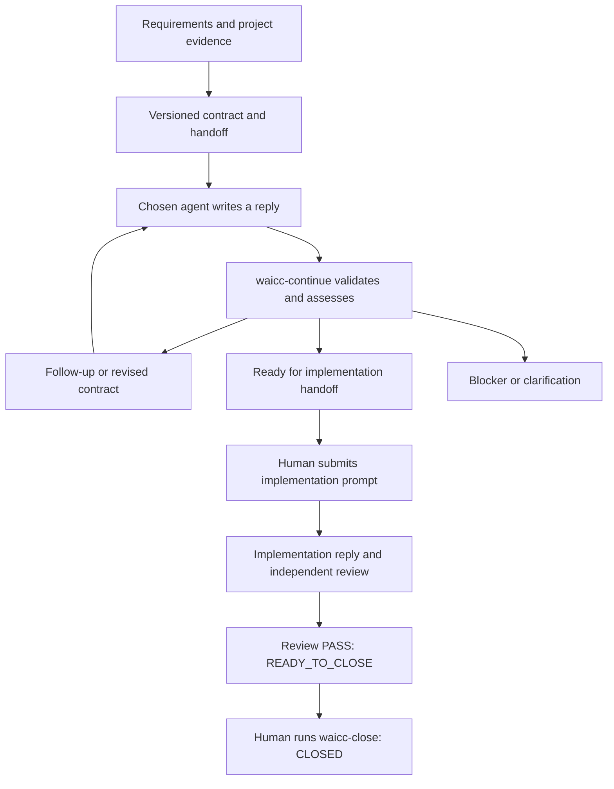

# WAICC — Whatley AI Communication Contract

_Clear contracts. Connected agents._

`pi-waicc` is a Pi extension that turns a development request into versioned
contracts, agent handoff prompts, and a durable conversation inside your project.
It is designed for complicated work that needs explicit requirements, task
dependencies, focused design advice, independent planning or review, and continuity across agents.

The contract defines the job. The handoff prompt tells an agent how to perform it
and where to reply. Pi validates that reply, assesses the evidence, and prepares
the next decision or handoff. A fresh agent can pick up the assignment without
needing the original chat history.

## Install

Requires **Node.js 22.19+** and the **`@earendil-works` Pi coding-agent host**.
Developed and tested on native Windows with Pi 1.2.0; other platforms have not yet
been verified.

```sh
pi install git:github.com/whatley95/pi-waicc
```

Restart Pi or use `/reload`, then open your target project and resolve Pi's project
trust prompt before using WAICC. The package exposes the extension and all 15
skills: the 14 WAI skills plus the WAICC workflow skill.

To install for one project, run this from that project:

```sh
pi install --local git:github.com/whatley95/pi-waicc
```

For local development, use an absolute path to your clone:

```sh
pi install /absolute/path/to/pi-waicc
```

WAICC is independent of pi-yoowai. If both packages are enabled, select one copy
of each shared WAI skill in Pi's resource configuration to avoid duplicate names.

## Start a conversation

In Pi, describe the actual outcome and constraints:

```text
/waicc-planning Add customer search with pagination and account isolation. Preserve the existing response format and support the current frontend.
```

Pi saves your exact request, inspects the project, recalls relevant confirmed
memory, and prepares a contract with requirements, task dependencies, acceptance
criteria, and planned verification. Missing decisions remain visible as questions.

1. **Send the planning handoff.** Give the generated `STARTER.txt` prompt to your
   chosen agent with access to the project. It reads `HANDOFF.md`, the contract,
   relevant skills and prior conversation, then writes the designated `reply.json`.
2. **Continue in Pi.** Run `/waicc-continue`. WAICC validates the request identity,
   contract version, requirements digest and source state. Pi then assesses the
   reply against the original requirements and actual evidence.
3. **Resolve or hand off.** Pi records the assessment and either generates a
   follow-up, reports a blocker, or prepares an implementation contract and prompt.
   A proposed contract is adopted explicitly; the responding agent cannot overwrite
   the canonical contract.
4. **Choose when implementation begins.** Submit the implementation prompt to your
   coding agent. After it writes its reply, use `/waicc-continue`. Implementation
   proceeds to `NEEDS_REVIEW`; it is not automatically certified as complete.
5. **Request independent review.** Use `/waicc-review Review authorization, regressions and test evidence`
   in the same session. Send that handoff to a reviewer, then run `/waicc-continue`
   when its reply is ready.
6. **Close explicitly.** A passing full-contract assessment shows `READY_TO_CLOSE`
   and `contractReview: PASS`. Run `/waicc-close <reason>` only when you decide the
   contract discussion is finished. This does not certify code delivery.



Use one session for one development objective, with multiple request/reply rounds.
`/waicc-status` shows the current state, pending reply, last assessment and next
action. After an interruption, use `/waicc-use <session-id>` to resume.

## Contracts for complicated work

The master contract preserves the overall requirements. Task contracts inside it
describe smaller outcomes, their dependencies, permitted source paths and acceptance
criteria. For example, agree the API/data behavior before backend and frontend
implementation, then verify their integration against the original requirements.

Requirements have stable IDs and exact quotes from the original request or an
amendment. Acceptance criteria link back to those IDs and distinguish planned
verification from actual results. Dependency cycles, unknown references and unsafe
paths are rejected.

Every handoff identifies the role, pinned inputs, permitted changes, expected
deliverables, response format and stopping conditions. It also includes recent
replies, findings, assessment decisions and check evidence. Changed requirements or
source invalidate affected replies instead of silently accepting stale work.

WAICC records these dependencies and conversations. It does not automatically
schedule parallel implementations or certify that dependent tasks are complete.

## What v0.1.0 does

- Generates versioned JSON contracts and readable Markdown from the same data.
- Produces starter prompts, detailed handoffs and matching reply templates.
- Supports focused contract-advisor questions without implying planning readiness.
- Validates and freezes replies before Pi assesses them.
- Preserves original requirements, amendments, contract history and decisions.
- Detects stale source, incomplete coverage and changes outside implementation scope.
- Bundles WAI skills and supports source-linked, human-confirmed project memory.
- Exports portable handoffs and recovers committed state after interrupted writes.

External agents run when you submit their prompts. Preparation and assessment use
your existing Pi agent and configured model. This release does not launch native
Claude/Codex processes, edit application source, commit, push or deploy.

Planning, review and advisor handoffs instruct agents to inspect source and write only their
designated reply. Their actual permissions remain the responsibility of the invoking
environment; prompt instructions are not an OS sandbox. A ready contract or passing
model assessment is not proof of tested delivery.

## Commands

| Command                                          | Purpose                                                                                               |
| ------------------------------------------------ | ----------------------------------------------------------------------------------------------------- |
| `/waicc-planning <requirements>`                 | Start a new durable task/session and ask Pi to prepare its contract                                   |
| `/waicc-review <focus>`                          | Prepare review in this chat's selected session; without a selection, start from supplied requirements |
| `/waicc-advisor [--requirements IDs] <question>` | Ask for focused advice on the saved contract; no automatic revision or readiness                      |
| `/waicc-continue`                                | Import/validate the waiting reply, assess it, or resume an unfinished draft                           |
| `/waicc-status [all\|session-id]`                | Show selected progress or list project sessions                                                       |
| `/waicc-use <session-id>`                        | Resume an existing project session in this Pi chat                                                    |
| `/waicc-close <reason>`                          | Explicitly close a fresh, passing full-contract review in READY_TO_CLOSE                              |
| `/waicc-reopen <reason>`                         | Reopen a closed contract; clears PASS and requires a fresh review                                     |
| `/waicc-amend <requirement change>`              | Append original-scope amendments and invalidate pending requests                                      |
| `/waicc-cancel <reason>`                         | Cancel an outstanding handoff without deleting history                                                |
| `/waicc-export`                                  | Package the pending handoff, requirements, contract and selected skill references                     |
| `/waicc-limit <2–20>`                            | Explicitly adjust the default 12-round limit                                                          |
| `/waicc-memory [query]`                          | Inspect candidate/active/stale memory                                                                 |
| `/waicc-memory confirm\|revoke <id>`             | Human curation of a memory entry                                                                      |
| `/waicc-ignore`                                  | Configure SVN ignore rules explicitly; Git is automatic                                               |

Bindings are per Pi chat and repository, persisted in Pi's session entries. Multiple
sessions are never silently resolved by choosing the newest. `/waicc-use` provides
explicit recovery if Pi's history is unavailable.

`/waicc-status all` lists each session's ID, status, `createdAt` and `updatedAt`,
plus `contractReview` and `deliveryVerified`, sorted by most recent activity first.
Both timestamps also appear in single-session
status. Times are UTC: creation stays fixed; update time is the latest committed
session event (including handoffs, reply intake, assessments, amendments, exports
and round-limit changes). Reading status or waiting for a reply does not update it;
neither do unrelated file edits or writing an external reply before intake. Older
sessions recover their update time from the existing journal without migration.

## Finish a contract discussion

`READY_TO_CLOSE` means **review passed; waiting for your final decision**.
`CLOSED` means **you explicitly finished the contract discussion**. Review agents
recommend readiness; only an assessed full-contract review can record PASS. No
assessment closes the contract automatically.

```text
/waicc-close Contract accepted for implementation
```

The resulting status includes:

```json
{
  "status": "CLOSED",
  "contractReview": "PASS",
  "deliveryVerified": false
}
```

To finish at contract generation rather than implementation, do not submit the
implementation handoff. If one is pending, explicitly `/waicc-cancel Pause implementation for contract-only review`,
then `/waicc-review Check full-contract requirements, dependencies, acceptance criteria and planned verification`.
Send that handoff to a reviewer. When its reply is ready, `/waicc-continue` starts
assessment; close only after it reaches `READY_TO_CLOSE`.

Closure requires the latest passing review to match the current contract,
requirements and source, with no reply pending. A changed source makes status show
`STALE` instead, without rewriting history or update time. A revised contract must
be reviewed in a new round; task-only reviews, planning readiness and advice cannot
close the whole contract. `/waicc-review` on a saved contract targets its current
version without silently creating a revision.

Closed sessions remain selectable and readable, but their mutations are blocked.
To reconsider one:

```text
/waicc-reopen Reconsider pagination requirements
```

Reopening records the reason and resets it to `NEEDS_REVIEW` with
`contractReview: NOT_REVIEWED`. Revise or amend as needed, then obtain a fresh review
before closing again. Closure/reopening history is retained. Closing, reopening
and a review PASS never set `deliveryVerified` (or legacy `verified`) to true.
These commands are explicit user actions, not agent tools; they are not an OS-level
permission boundary against an agent with shell/filesystem access.

The CLI equivalents are `close <session-id> <reason>` and `reopen <session-id> <reason>`
with `--root <project>`. Older `READY_FOR_HANDOFF` records are preserved, not silently
upgraded to PASS; request a fresh review to use closure.

## Ask a contract advisor

Use an advisor for a focused decision on an **existing saved contract**, such as
architecture, a risky assumption, or choosing between approaches:

```text
/waicc-advisor Should we use cursor or offset pagination for this contract?
```

Optionally select requirement IDs for the advice's coverage rows:

```text
/waicc-advisor --requirements REQ-001,REQ-002 Compare the authorization approaches and their trade-offs.
```

Without selected IDs, it answers the question only (`coverage: []`); it does not
claim whole-contract coverage. The advisor reads the contract, relevant source,
selected skills, recent discussion and a snapshot of relevant confirmed memory.
It returns options with benefits, trade-offs and evidence, a recommendation,
assumptions, and suggested amendments. Completed advice compares at least two
options; insufficient information should produce questions or a blocker instead.

Send the generated `STARTER.txt` to your chosen agent. After its `reply.json` is
ready, run `/waicc-continue`. Pi checks the advice and records `noted` →
`ADVICE_READY`, asks a focused follow-up, or records the blocker. **Advice never
adopts amendments, changes the contract, confirms memory, marks the plan ready,
or generates an implementation handoff.** Findings and unverified coverage remain
visible even when advice is noted. Tell Pi which recommendation you accept before
it explicitly prepares a revised planning/review contract. New scope still needs
`/waicc-amend`; for whole-contract verification use `/waicc-review`.

Only one request can be pending per session. Finish it first, or explicitly pause
it with `/waicc-cancel Pause planning to obtain focused advice` before asking the
advisor. The advisor command itself needs no model call and creates no new contract
version. It uses the same reply identity, freshness checks, history, export and
round limits as other handoffs.

Standalone CLI equivalent:

```sh
node src/cli.ts --root <project> advisor <session-id> --requirements REQ-001 "Which pagination approach fits?"
```

## Project storage and version control

```text
myproject/
  .pi/pi-waicc/
    .gitignore
    write.lock                    # Present only during a mutation
    memory/entries.json
    sessions/<session-id>/
      requirements.md             # Original request, never rewritten
      amendments/<number>.md
      session.json                # Disposable display cache
      journal/<sequence>-<id>.json # Immutable authoritative transactions
      contracts/v001/
        contract.json
        CONTRACT.md
      rounds/<request-id>/
        request.json
        HANDOFF.md
        STARTER.txt
        reply.example.json
        conversation.json         # Recent replies, decisions and check evidence
        memory.json               # Advisor only: relevant confirmed memory at issue
        skills/                   # Only guidance selected for this handoff
        reply.json                # Written by the external agent
        received.json             # Frozen response after validation
        assessment.json
      exports/<export-id>/
      lifecycle/<closure-id>/
        closure.json              # Pinned PASS, explicit reason and close time
        CLOSURE.md
        reopen.json               # Present if this closure was reopened
```

Git ignores generated state using a `.gitignore` inside `.pi/pi-waicc`; no root
ignore-file changes are needed. Already-tracked files remain tracked: remove them
from tracking yourself before relying on an ignore rule.

For SVN, run `/waicc-ignore` before preparing the first handoff. Existing ignore
rules are preserved. If `.pi` is versioned, `pi-waicc` is ignored there; otherwise
`.pi` is ignored at the working-copy root. This is an explicit SVN property change
that you can inspect with `svn diff`. It does not schedule files for addition.

Exports contain the requirements, contract, recent conversation and selected skills
(plus the confirmed memory snapshot for advisor handoffs);
they do not copy the source checkout or authentication files. The recipient needs
matching source separately. Exported paths are portable; return the resulting
`reply.json` to the original round's designated location. `manifest.json` identifies
its inputs. Review project content before sharing an export.

## Memory and WAI skills

The model can recall confirmed knowledge and propose facts, decisions or lessons
through `waicc_memory`. Each entry pins a project-relative evidence file and digest.
Candidates do not enter automatic recall until a human confirms them. Changed or
missing evidence makes an entry stale; reading or repeating it never renews it.
File existence is not semantic verification. Keep speculative fixes and unfinished
work in the session, not durable memory.

All WAI skills and their linked domain/design references are packaged. They load
on demand; external handoffs carry selected copies and do not require WAI tools.
The collection covers API contracts, debugging, delivery, dependency upgrades,
Flutter, Kotlin, learning, Node.js, refactoring, security, interface design, Spring,
testing and web development.

Automatic skill rewriting, global personal memory, background reflection/model
calls, and learning from unverified replies are intentionally absent in 0.1.0.
See [skill provenance](THIRD_PARTY_NOTICES.md).

## Integrity and limits

Contracts retain source quotes and stable requirement IDs. Dependency graphs must
be acyclic; acceptance criteria reference known requirements. Readiness requires
every requirement to have planned verification, addressed reply coverage, no open
questions or failed checks, and explicit dispositions for high/critical findings.
`verified` remains false: schema validity and model agreement do not prove tests ran.
Advisor `ADVICE_READY` is separate from readiness: it records a completed advice
exchange, not whole-contract coverage, resolution of findings, or permission to implement.

Git fingerprints include revision, index and working-tree/untracked nonignored file
content. SVN fingerprints include root revision, reported working-copy changes,
actual property values and source content, including untracked files. Common
untracked build/dependency directories and WAICC output are excluded; tracked source
is retained even under a build-named directory. Symlinks/junctions fail closed rather
than expanding scope.
Limits: 10,000 files, 128 MB source content, 128,000-character contracts and 256 KB
replies. Large monorepos should use a smaller checkout; per-subtree fingerprint
configuration and cross-repository scheduling are future work. There is no automatic
parallel implementation scheduler or task-completion certification in this release.

State writes use one project writer lock and atomic journal commits. A corrupt
`session.json` cache does not lose committed state. Incomplete pre-commit artifacts
can be replaced on retry; committed artifacts are checked for modification. A dead
writer's lock can be recovered with `node src/cli.ts recover-lock --root <project>`;
the command refuses a live PID or uncertain machine identity.

## Develop and inspect

```sh
git clone https://github.com/whatley95/pi-waicc.git
cd pi-waicc
npm install --ignore-scripts
npm run check
node src/cli.ts --help
```

The automated suite covers contract and dependency validation, reply identity and
freshness, crash recovery, writer locks, path boundaries, Git/SVN evidence, memory,
exports, and actual Pi 1.2.0 extension loading and handoff-tool execution. Live-model
output quality still needs validation on real project work.

The standalone CLI can create, prepare, import, assess and export sessions without
running Pi. Run it with `--root <target-project>`; use explicit session IDs. See the
[protocol and example](docs/PROTOCOL.md) for the contract/reply/assessment formats.

See [the source repository](https://github.com/whatley95/pi-waicc) for development
and [open an issue](https://github.com/whatley95/pi-waicc/issues) for reproducible
problems. Include the Pi/Node versions and a redacted description of the affected
contract or round; project-local sessions are not uploaded automatically.

## License

[MIT](LICENSE). Bundled WAI skills and upstream design guidance retain their
[attribution and license notices](THIRD_PARTY_NOTICES.md).
